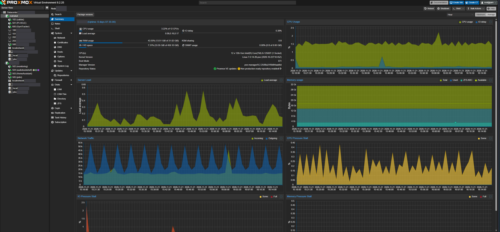
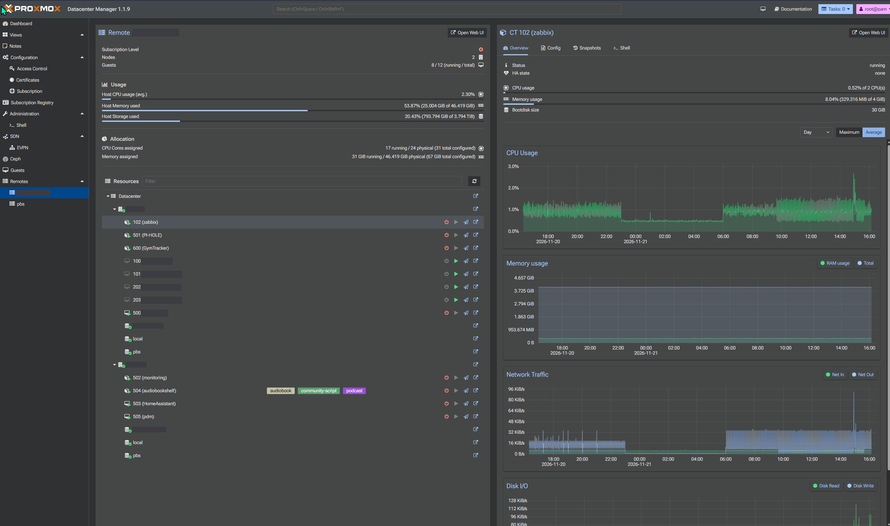

# Proxmox VE Cluster (2 nodes + QDevice)

A two-node **Proxmox VE 9** cluster built from second-hand mini PCs, with a **QDevice** tie-breaker on the backup server so the cluster keeps quorum when either node goes down. This repo holds the build notes, the fixes that made it stable, and the scripts I run on it.

```
            ┌──────────────── homelab cluster ────────────────┐
            │                                                  │
   pve1 (10.0.0.11)                                  pve2 (10.0.0.12)
   32 GB · ZFS "pve1-vms"                            16 GB · ZFS "pve2-vms"
   NAS VM, Zabbix, Pi-hole, apps, lab VMs            Home Assistant, Grafana, PDM, apps
            │                                                  │
            └──────────── vote ──── QDevice ──── vote ─────────┘
                              (corosync-qnetd on the
                               backup server 10.0.0.20)
```



Both nodes and every guest, seen from Proxmox Datacenter Manager:



## What's in here

| Path | What it does |
|---|---|
| [`scripts/homelab-audit.sh`](scripts/homelab-audit.sh) | **Read-only** health and tidiness check for a node: load, stuck processes, dead network mounts, ZFS, repos, certificates, every guest (ISO still attached, agent, snapshots, last backup), orphan disks, leftovers. Saves a report. |
| [`scripts/pve-backups.sh`](scripts/pve-backups.sh) | Exports the newest backup time per guest as a Prometheus metric for dashboards and alerts. |
| [`config/disable-nic-offload.service`](config/disable-nic-offload.service) | Fix for the Intel e1000e NIC hang on mini PCs. |
| [`config/journald-size.conf`](config/journald-size.conf) | Keeps the system journal under 500 MB. |

## Build notes

### 1. Cluster + QDevice
With only two nodes, losing one means losing quorum (1 of 2 votes), and the survivor stops starting/stopping guests. A QDevice on a third, always-on box adds a third vote.

```bash
# on the third box (here: the Proxmox Backup Server)
apt install corosync-qnetd
# on BOTH cluster nodes
apt install corosync-qdevice
# on ONE node
pvecm qdevice setup 10.0.0.20
pvecm status        # Expected votes: 3, Quorate: Yes, "Qdevice" listed
```

### 2. Node DNS
Point each node at your own DNS servers only (`node > System > DNS`). Leaving a public resolver such as `8.8.8.8` as a third entry looks harmless, but **Chrome on that machine then silently switches to encrypted DNS to Google** and bypasses Pi-hole entirely.

### 3. Repositories
Without a subscription, disable `pve-enterprise.sources` **and** `ceph.sources` and enable the *no-subscription* repo, otherwise `apt update` fails with 401 errors and updates pile up silently. In deb822 files, add `Enabled: no`.

### 4. Backups
All guests back up nightly to Proxmox Backup Server (see [proxmox-backup-server](https://github.com/nashibbhattrai766-max/proxmox-backup-server)):

| Job | Schedule | Guests |
|---|---|---|
| nightly | 02:00 | everything except lab VMs |
| weekly | Sun 03:00 | lab VMs |

### 5. Guest agents
Enable the QEMU guest agent on every VM (`qm set <id> --agent enabled=1`, then a **full stop/start**, not a reboot). Proxmox then shows the guest's IP, shuts it down cleanly, and freezes the filesystem for consistent backups.

## Lessons learned (the hard way)

- **A dead NFS mount causes a "high load" that isn't load.** After retiring an NFS backup share, both nodes still had it mounted. The NFS client thread hung for days and the load sat at a flat 10–12 while the CPU was 97 % idle. Clue: high load + zero CPU/IO pressure + a process in state `D`. Fix: `umount -l -c <path>` (`-c` skips the path check that would itself hang), then remove the storage and fstab entries. `homelab-audit.sh` now checks for this.
- **Backups after a full VM stop/start read the whole disk.** PBS uses dirty bitmaps to back up only changed blocks; they live in memory and are lost when a VM is stopped. Expect one heavy backup after any stop/start or memory change.
- **Containers report the host's load average.** An LXC (e.g. Zabbix) will alert on "high load" whenever the host is busy — that's not a second problem.
- **Ejected ISOs matter.** A VM with an installer ISO still attached produces backup warnings and keeps the ISO "in use". The audit lists them.
- **ZFS ARC** takes up to half the RAM by default; cap it on small nodes if guests are starved.

## Hardware

| Node | Box | RAM | Storage |
|---|---|---|---|
| pve1 | HP EliteDesk Mini, i5-12500T (6C/12T) | 32 GB | NVMe (ZFS) + USB RAID enclosure passed to the NAS VM |
| pve2 | HP ProDesk Mini (6C/12T) | 16 GB | NVMe (ZFS) |
| pbs | Lenovo ThinkCentre M700 Tiny | 16 GB | SATA SSD (OS) + USB HDD (backups) |

## License

MIT
